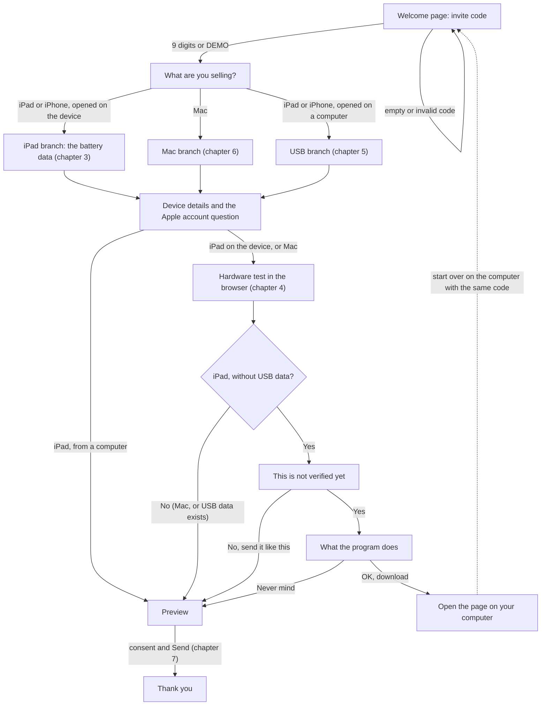
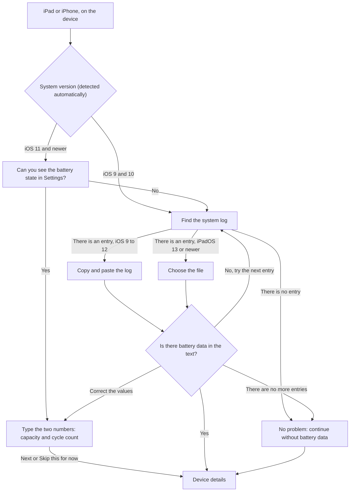
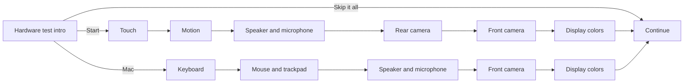
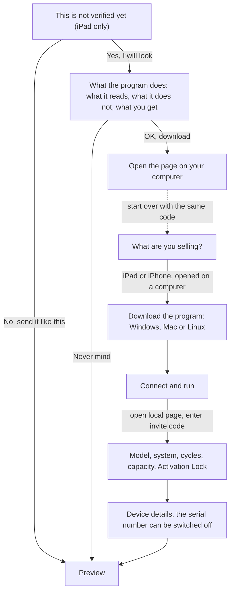
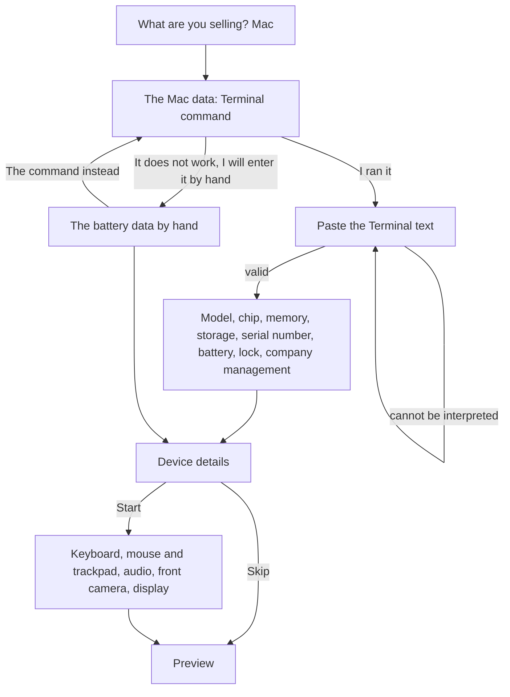
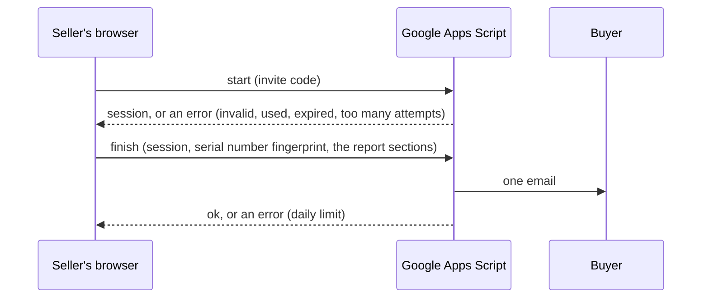
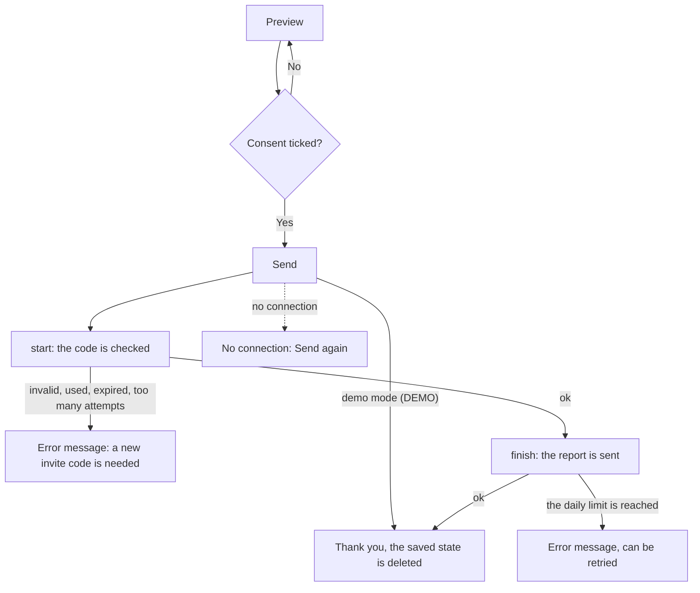

# Flows and decision paths

[Magyar](flows.md) | [English](flows.en.md)

This document describes every path of the seller wizard with Mermaid diagrams. The diagrams are built from the actual transitions in [web/seller.js](../web/seller.js). A Playwright flow walks every path, with a screenshot after each step.

## 1. How to look at it

Install the dependencies (once):

```
npm install
```

Run every flow and build the step-by-step gallery:

```
npm run flows
```

The gallery then opens in a browser here:

```
flows-out/index.html
```

In the gallery each flow is one row: the steps from left to right as screenshots, with the title below. Clicking an image opens it at full size.

Only the tests, without the gallery:

```
npm run e2e
```

Only rebuild the gallery from the existing images:

```
npm run gallery
```

The local server uses the fixed port 8766 and is started by [scripts/serve.sh](../scripts/serve.sh). The `#DEMO` page has a list at the top with a button for every screen and state that jumps straight there (chapter 10).

The tests use the Google Chrome installed on the machine. A non-touch device is no obstacle: touch is replaced by real touch events sent over the Chrome DevTools protocol. The camera and microphone come from Chrome's fake devices.

## 2. Full flow



When the seller opens the page on an iPad or iPhone using the continuation link (`#CODE.SESSION`), or when opened directly on iOS, the interface automatically jumps to the browser hardware test introduction (`web_intro`), skipping the device selection prompt.

## 3. iPad and iPhone: the battery data



iOS 9 and 10 show no battery state in Settings, so the system log is the first route there. For iOS 9 to 12 the seller pastes the log, from iPadOS 13 they pick a file. The page detects the system version from the browser.

## 4. Hardware test



Every test has three outcomes: it runs (a result), the seller skips it, or the browser does not allow it (camera and microphone on iOS 9 and 10). On a Mac: keyboard, mouse and trackpad, audio, front camera and display.

| Test                     | What it measures                                                                                                                                  | Tag in the report | Works from                                       |
| ------------------------ | ------------------------------------------------------------------------------------------------------------------------------------------------- | ----------------- | ------------------------------------------------ |
| Keyboard (Mac)           | every key lights up when pressed, ANSI or ISO layout, the top function row only with Fn, a double press raises a suspicion                        | measured          | any modern browser (needs the physical key code) |
| Mouse and trackpad (Mac) | the cursor over a grid, five click points (the corners too), right click, scrolling up and down. Optional: horizontal scroll, pinch, double click | measured          | any modern browser                               |
| Touch screen             | an 8x12 grid, every cell must be sensed, at the end two fingers                                                                                   | measured          | iOS 9                                            |
| Motion sensors           | 3-axis acceleration (X, Y, Z) and bidirectional rotation (gyroscope)                                                                              | measured          | iOS 9 (asks permission from iOS 13)              |
| Speaker and microphone   | four tones on the left and right channel, whether the microphone hears them                                                                       | measured          | iOS 11                                           |
| Rear and front camera    | whether a live, non-uniform image arrives                                                                                                         | measured          | iOS 11                                           |
| Display colors           | six colors, the seller says if something looks wrong                                                                                              | self-reported     | iOS 9                                            |

The keyboard test cannot see the Fn, volume, brightness and Touch ID keys, because the system swallows them. Physical buttons (volume, Home, lock) are monitored during the USB battery stress test; a test for the headphone jack and charging port does not exist. The presence of the camera, the microphone and the touch controller could be read over USB, but that would not prove they work. This is not built in yet.

## 5. The USB program offer and the computer branch



The results of the browser tests done on the iPad **do not carry over** to the computer, because the system stores nothing. In the report started from the computer they are marked "not tested", while the battery, model, storage, serial number and Activation Lock come from USB.

## 6. Mac



## 7. Sending and the backend





In demo mode (`DEMO`) no network request goes out, a test guards this.

## 8. The report and the decisions

Every report row gets a source tag, so the buyer sees what was measured and what is self-reported.

| Tag                                             | Meaning                                                  |
| ----------------------------------------------- | -------------------------------------------------------- |
| USB-ből (from USB)                              | the device gave it through the USB program, hard to fake |
| naplóból, fájlból (from the log, from the file) | the device's own system log, pasted by the seller        |
| parancsból (from the command)                   | the output of the Mac Terminal command                   |
| beírta (typed in)                               | the seller typed it                                      |
| böngészőből (from the browser)                  | the page read it itself (for example the system version) |
| mért (measured)                                 | the result of a test measured in the browser             |
| bemondás (self-reported)                        | the seller's answer (display colors, Apple account)      |

The text of missing data depends on the decision:

| Situation                                                           | What the report says                                                     |
| ------------------------------------------------------------------- | ------------------------------------------------------------------------ |
| iPad, no USB data: model, storage, serial number                    | cannot be read without USB                                               |
| iPad, no battery data                                               | no data, to be completed with a USB measurement                          |
| hardware test skipped                                               | not tested                                                               |
| the browser does not allow it (iOS 9 and 10, camera and microphone) | the browser does not allow it on this system, so it could not be checked |
| Apple account                                                       | always the seller's word, cannot be read over USB on an iPad either      |

## 9. Flows

All the flows below run (`npm run e2e`). Their files are [tests/e2e/flows.spec.js](../tests/e2e/flows.spec.js) and [tests/e2e/backend.spec.js](../tests/e2e/backend.spec.js). [tests/e2e/screens.spec.js](../tests/e2e/screens.spec.js) takes a picture of every screen in chapter 10.

| Id                              | Flow                                                                      | Group                                  | Steps |
| ------------------------------- | ------------------------------------------------------------------------- | -------------------------------------- | ----- |
| `ios9-back-and-reload`          | Back button and page reload (old iPads often reload the page)             | iPad, iOS 9 and 10                     | 9     |
| `ios9-log-bad-text`             | Bad log text, then "no more entries"                                      | iPad, iOS 9 and 10                     | 6     |
| `ios9-log-hw-send`              | Log pasted, hardware tests, USB program declined, send                    | iPad, iOS 9 and 10                     | 24    |
| `ios9-log-hw-usb-offer`         | Log pasted, hardware tests, then the USB program is accepted              | iPad, iOS 9 and 10                     | 23    |
| `ios9-nolog-minimal`            | No log entry, no hardware test, no USB: the shortest path                 | iPad, iOS 9 and 10                     | 10    |
| `ios9-usb-offer-declined-later` | Reads the USB program description, then declines                          | iPad, iOS 9 and 10                     | 10    |
| `ios12-battery-validation`      | Invalid battery values, correction and skip                               | iPad, iOS 11 and 12                    | 7     |
| `ios12-no-settings-log`         | No battery screen in Settings, log pasted                                 | iPad, iOS 11 and 12                    | 12    |
| `ios12-settings-all-hw`         | Battery from Settings, every hardware test (fake camera and microphone)   | iPad, iOS 11 and 12                    | 26    |
| `ios14-file-upload`             | Analytics file chosen in the file picker                                  | iPad, iPadOS 13 and 14                 | 12    |
| `ios14-file-without-battery`    | File without battery data, then "no more entries"                         | iPad, iPadOS 13 and 14                 | 7     |
| `ios17-everything`              | Settings, every hardware test, USB program description then declined      | iPad, iPadOS 15 and newer              | 26    |
| `ios17-skip-all-hw`             | Skips every hardware test one by one                                      | iPad, iPadOS 15 and newer              | 16    |
| `pc-linux-usb`                  | Linux, iPad read over USB                                                 | Computer, USB reading (iPad or iPhone) | 10    |
| `pc-mac-usb`                    | Mac computer, download from Terminal, iPad read over USB                  | Computer, USB reading (iPad or iPhone) | 10    |
| `pc-win-bad-usb`                | Invalid data, then restart the reader                                     | Computer, USB reading (iPad or iPhone) | 5     |
| `pc-win-serial-hidden`          | Serial number sending switched off: only the fingerprint goes out         | Computer, USB reading (iPad or iPhone) | 10    |
| `pc-win-usb`                    | Windows, iPad read over USB                                               | Computer, USB reading (iPad or iPhone) | 10    |
| `mac-bad-paste`                 | Mac: bad Terminal output pasted                                           | Selling a Mac                          | 5     |
| `mac-command-hw`                | Mac: Terminal command, audio, front camera, display                       | Selling a Mac                          | 29    |
| `mac-keyboard-double`           | Mac: the A key reacts twice to one press (double press suspect)           | Selling a Mac                          | 15    |
| `mac-keyboard-iso`              | Mac: ISO (European, Hungarian) keyboard, without the function row         | Selling a Mac                          | 15    |
| `mac-keyboard-missing`          | Mac: two keys do not respond (Q and up arrow), the test fails             | Selling a Mac                          | 15    |
| `mac-keyboard-pointer-skip`     | Mac: keyboard and mouse tests skipped, shown as not tested in the report  | Selling a Mac                          | 14    |
| `mac-manual`                    | Mac: the command does not work, manual entry, no hardware test            | Selling a Mac                          | 9     |
| `mac-pointer-partial`           | Mac: the trackpad corners and the right click do not work, the test fails | Selling a Mac                          | 15    |
| `welcome-code-errors`           | Welcome page: empty and invalid invite codes, the sample report           | Opening and errors                     | 5     |
| `demo-sends-nothing`            | Demo mode (DEMO): nothing goes out on the network                         | Sending and backend error paths        | 9     |
| `send-invalid-invite`           | Send: invalid invite code                                                 | Sending and backend error paths        | 9     |
| `send-needs-consent`            | Send: not active without consent                                          | Sending and backend error paths        | 10    |
| `send-network-retry`            | Send: no connection, then the retry succeeds                              | Sending and backend error paths        | 10    |
| `send-quota`                    | Send: the daily report limit is reached                                   | Sending and backend error paths        | 9     |
| `send-success`                  | Successful send: start, then finish                                       | Sending and backend error paths        | 10    |
| `send-used-invite`              | Send: invite code already used                                            | Sending and backend error paths        | 9     |

## 10. Demo screens

Appending a hyphen and the id to `#DEMO` jumps straight to that state, for example `#DEMO-ios9-review-log`. These exist only on the `#DEMO` address. The screen titles are the Hungarian names shown in the app.

In demo mode nothing has to be run: the USB result uses a made-up sample, the Mac Terminal and iOS log fields are prefilled, and the file picker screen has a "use sample file" button. Reading goes through the real parser. With a real invite code the paste fields stay empty, a test guards this.

**Opening**

| Deep link    | Screen                  |
| ------------ | ----------------------- |
| `#DEMO-kind` | Milyen eszközt adsz el? |

**iPad, iOS 9 and 10**

| Deep link                    | Screen                                            |
| ---------------------------- | ------------------------------------------------- |
| `#DEMO-ios9-log-ask`         | Rendszernapló keresése                            |
| `#DEMO-ios9-log-paste`       | Napló beillesztése                                |
| `#DEMO-ios9-nolog`           | Nincs napló bejegyzés                             |
| `#DEMO-ios9-details-nodata`  | Az eszköz adatai, még nincs akku adat             |
| `#DEMO-ios9-details-log`     | Az eszköz adatai, napló beolvasva                 |
| `#DEMO-ios9-hw-intro`        | Hardverteszt bevezető                             |
| `#DEMO-ios9-hw-touch`        | Érintőképernyő teszt                              |
| `#DEMO-ios9-hw-motion`       | Mozgásérzékelő teszt                              |
| `#DEMO-ios9-hw-audio`        | Hang és mikrofon (iOS 9-en nem ellenőrizhető)     |
| `#DEMO-ios9-hw-camera-rear`  | Hátlapi kamera (iOS 9-en nem ellenőrizhető)       |
| `#DEMO-ios9-hw-camera-front` | Előlapi kamera (iOS 9-en nem ellenőrizhető)       |
| `#DEMO-ios9-hw-display`      | Kijelző színei                                    |
| `#DEMO-ios9-hw-buttons`      | Fizikai gombok tesztje                            |
| `#DEMO-ios9-remaining-nolog` | Mi maradt, akku adat nélkül                       |
| `#DEMO-ios9-remaining-log`   | Mi maradt, napló beolvasva                        |
| `#DEMO-ios9-usb-about`       | Mit csinál az USB-s program                       |
| `#DEMO-ios9-usb-switch`      | Nyisd meg a számítógépeden                        |
| `#DEMO-ios9-review-nolog`    | Előnézet: akku adat nélkül, hardverteszt kihagyva |
| `#DEMO-ios9-review-log`      | Előnézet: napló, hardverteszt iOS 9 szerint       |
| `#DEMO-ios9-review-weak`     | Előnézet: kopott akku, hibás tesztek              |
| `#DEMO-ios9-done`            | Köszönjük (a küldés után)                         |

**iPad, iOS 11 and 12**

| Deep link                  | Screen                                     |
| -------------------------- | ------------------------------------------ |
| `#DEMO-mid-screen-ask`     | Látod az akku állapotát a Beállításokban?  |
| `#DEMO-mid-screen-enter`   | Akku értékek beírása                       |
| `#DEMO-mid-log-ask`        | Rendszernapló keresése                     |
| `#DEMO-mid-log-paste`      | Napló beillesztése                         |
| `#DEMO-mid-hw-audio`       | Hang és mikrofon teszt                     |
| `#DEMO-mid-hw-camera-rear` | Hátlapi kamera teszt                       |
| `#DEMO-mid-review`         | Előnézet: beírt akku, minden teszt rendben |

**iPad, iPadOS 13 and 14**

| Deep link                   | Screen                                    |
| --------------------------- | ----------------------------------------- |
| `#DEMO-modern-screen-ask`   | Látod az akku állapotát a Beállításokban? |
| `#DEMO-modern-screen-enter` | Akku értékek beírása                      |
| `#DEMO-modern-log-ask`      | Analitikai fájl keresése                  |
| `#DEMO-modern-log-file`     | Fájl kiválasztása                         |
| `#DEMO-modern-review`       | Előnézet: fájlból, minden teszt rendben   |

**iPad, iPadOS 15 and newer**

| Deep link                 | Screen                                        |
| ------------------------- | --------------------------------------------- |
| `#DEMO-latest-screen-ask` | Látod az akku állapotát a Beállításokban?     |
| `#DEMO-latest-log-file`   | Fájl kiválasztása                             |
| `#DEMO-latest-hw-audio`   | Hang és mikrofon teszt                        |
| `#DEMO-latest-remaining`  | Mi maradt, minden teszt rendben               |
| `#DEMO-latest-review-ok`  | Előnézet: minden rendben                      |
| `#DEMO-latest-review-bad` | Előnézet: hibás tesztek, kijelentkezés nélkül |

**Computer, USB reading (iPad or iPhone)**

| Deep link              | Screen                                             |
| ---------------------- | -------------------------------------------------- |
| `#DEMO-pc-win-get`     | Letöltés: Windows                                  |
| `#DEMO-pc-mac-get`     | Letöltés: Mac                                      |
| `#DEMO-pc-linux-get`   | Letöltés: Linux                                    |
| `#DEMO-pc-run`         | Csatlakoztatás és futtatás                         |
| `#DEMO-pc-result`      | Kiolvasott adatok                                  |
| `#DEMO-pc-details`     | Az eszköz adatai, USB-ből kitöltve                 |
| `#DEMO-pc-review`      | Előnézet: USB-s adatok, Aktiválási zár kikapcsolva |
| `#DEMO-pc-review-lock` | Előnézet: Aktiválási zár BEKAPCSOLVA               |
| `#DEMO-pc-review-weak` | Előnézet: kopott akku                              |
| `#DEMO-pc-done`        | Köszönjük (a küldés után)                          |

**Selling a Mac**

| Deep link               | Screen                                                     |
| ----------------------- | ---------------------------------------------------------- |
| `#DEMO-mac-run`         | Terminál-parancs futtatása                                 |
| `#DEMO-mac-paste`       | A kimenet beillesztése                                     |
| `#DEMO-mac-manual`      | Kézi megadás (ha a parancs nem megy)                       |
| `#DEMO-mac-details`     | Az eszköz adatai, parancsból kitöltve                      |
| `#DEMO-mac-hw-intro`    | Hardverteszt bevezető                                      |
| `#DEMO-mac-hw-keyboard` | Billentyűzet teszt                                         |
| `#DEMO-mac-hw-pointer`  | Egér és trackpad teszt                                     |
| `#DEMO-mac-hw-audio`    | Hang és mikrofon teszt                                     |
| `#DEMO-mac-review-ok`   | Előnézet: minden rendben                                   |
| `#DEMO-mac-review-mdm`  | Előnézet: céges felügyelet, zár bekapcsolva, hibás tesztek |
| `#DEMO-mac-review-nohw` | Előnézet: hardverteszt kihagyva                            |
| `#DEMO-mac-done`        | Köszönjük (a küldés után)                                  |

## 11. What the automation does not cover

- The screenshots come from Chrome, not Safari. Safari 9 specifics (for example that `isTrusted` is not provided) have to be tried on a real iPad.
- The audio test runs with Chrome's fake microphone, so its result is often partial or failing. The camera test runs with the fake camera and without the `facingMode` constraint, because the fake camera does not know it.
- The keyboard and mouse tests run with Playwright's real (trusted) input events. The behavior of a real Mac keyboard and trackpad (the Caps Lock press, system keys being swallowed, the two-finger click) has to be tried on a real Mac.
- Real USB reading, the real Apps Script and real touch on a real device are not automated. Backend calls are replaced by fake answers, the tests never reach the live backend.
