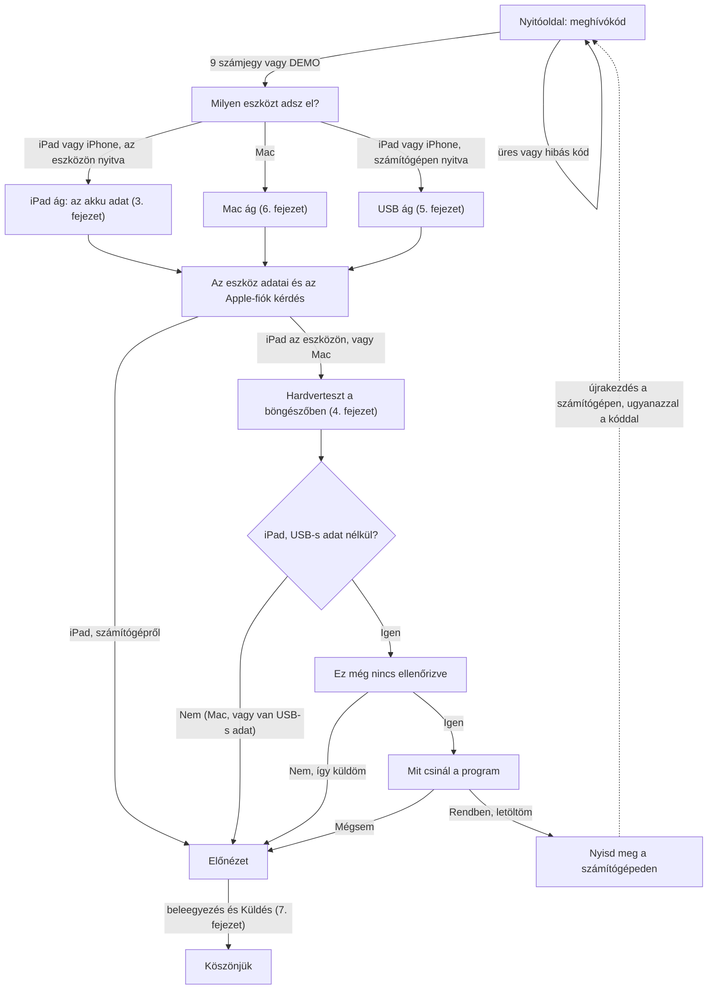
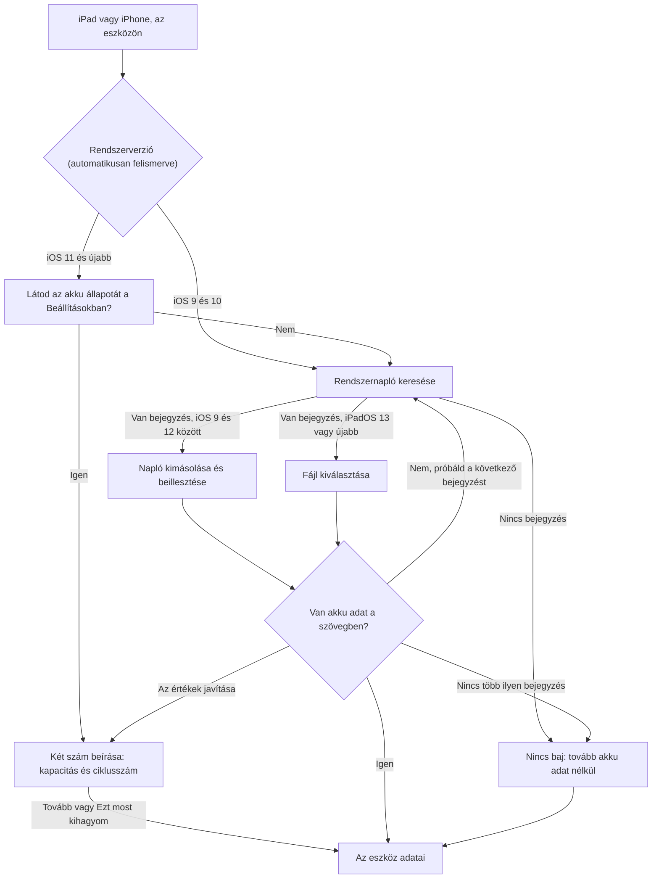
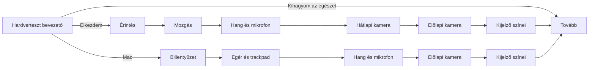
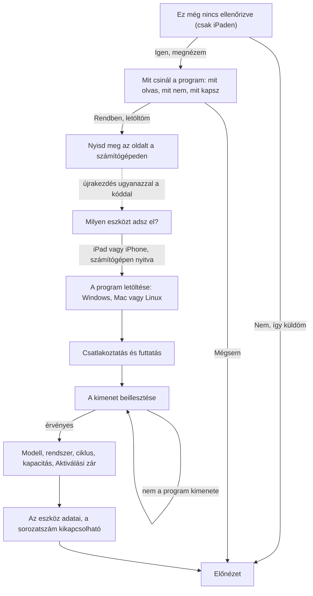
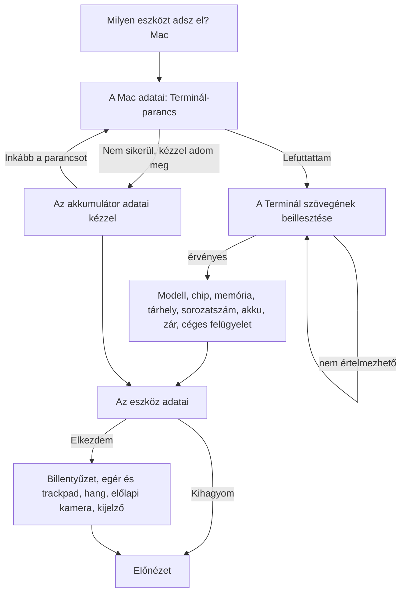
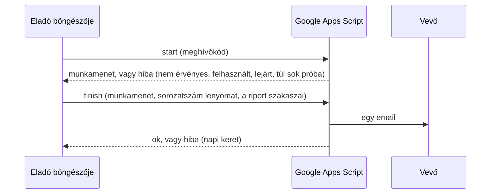
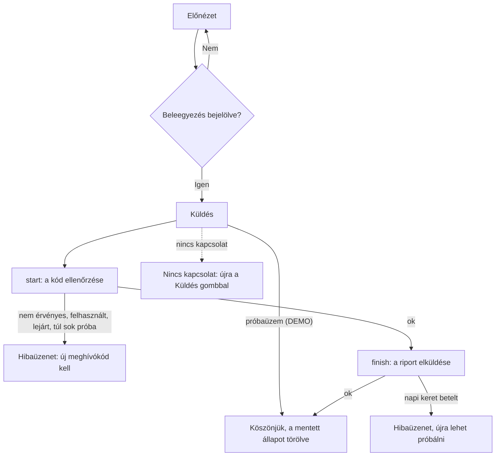

# Folyamatok és döntési útvonalak

[Magyar](flows.md) | [English](flows.en.md)

Ez a dokumentum az eladói varázsló összes útvonalát leírja, Mermaid diagramokkal. A diagramok a [web/seller.js](../web/seller.js) tényleges átmeneteiből készültek. Minden útvonalat egy Playwright forgatókönyv is végigjár, lépésenként képernyőképpel.

## 1. Hogyan nézheted meg

Függőségek telepítése (egyszer):

```
npm install
```

Minden forgatókönyv lefuttatása, majd a lépésenkénti galéria megépítése:

```
npm run flows
```

Ezután a galéria itt nyílik meg (böngészőben):

```
flows-out/index.html
```

A galériában minden forgatókönyv egy sor, balról jobbra a lépések képernyőképekkel, alattuk a főcímmel. Egy képre kattintva a teljes méretű kép nyílik.

Csak a tesztek, galéria nélkül:

```
npm run e2e
```

Csak a galéria újraépítése a meglévő képekből:

```
npm run gallery
```

A helyi szerver fix portja a 8766, a [scripts/serve.sh](../scripts/serve.sh) indítja. A `#DEMO` oldalon felül egy lista van minden képernyőre és állapotra, egy kattintással odaugrik (10. fejezet).

A tesztek a gépen lévő Google Chrome-ot használják. A nem érintőképernyős gép nem akadály: az érintést a Chrome fejlesztői protokollján küldött valódi érintés-események helyettesítik. A kamerát és a mikrofont a Chrome hamis eszközei adják.

## 2. Teljes folyamat



## 3. iPad és iPhone: az akku adat



Az iOS 9 és 10 nem mutat akku állapotot a Beállításokban, ott a rendszernapló az első út. Az iOS 9 és 12 közötti rendszerek naplóját az eladó beilleszti, az iPadOS 13-tól fájlt választ ki. A rendszerverziót az oldal a böngészőből ismeri fel.

## 4. Hardverteszt



Minden tesztnél három kimenet lehet: lefut (eredmény), kihagyja az eladó, vagy a böngésző nem engedi (iOS 9 és 10 kamerára és mikrofonra). Macen: billentyűzet, egér és trackpad, hang, előlapi kamera és kijelző.

| Teszt | Mit mér | Jelölés a riportban | Mikortól működik |
|---|---|---|---|
| Billentyűzet (Mac) | minden billentyű lenyomásra kigyullad, ANSI vagy ISO kiosztás, a felső funkciósor csak az Fn-nel, a dupla leütés gyanút jelzi | mért | minden modern böngészőben (kell a billentyű fizikai kódja) |
| Egér és trackpad (Mac) | a kurzor rácson, öt kattintási pont (a sarkok is), jobb kattintás, görgetés fel és le. Nem kötelező: vízszintes görgetés, csippentés, dupla kattintás | mért | minden modern böngészőben |
| Érintőképernyő | 8x12 mezős rács, minden mezőt érzékelni kell, a végén két ujj | mért | iOS 9-től |
| Mozgásérzékelők | a gyorsulás tartománya mindkét tengelyen és a forgás | mért | iOS 9-től (iOS 13-tól engedélyt kér) |
| Hangszóró és mikrofon | négy hangjelzés a bal és a jobb csatornán, a mikrofon meghallja-e | mért | iOS 11-től |
| Hátlapi és előlapi kamera | élő, nem egyszínű kép érkezik-e | mért | iOS 11-től |
| Kijelző színei | hat szín, az eladó jelzi, ha hibát lát | bemondás | iOS 9-től |

A billentyűzet teszt nem látja az Fn, a hangerő, a fényerő és a Touch ID billentyűt, mert a rendszer elnyeli őket. A gombok, a fejhallgató-aljzat és a töltőport tesztje nincs meg. A kamera, a mikrofon és az érintővezérlő jelenléte USB-n át kiolvasható lenne, de a működésüket nem bizonyítja. Ez még nincs beépítve.

## 5. Az USB-s program ajánlata és a számítógépes ág



Az iPaden megcsinált böngészős tesztek eredménye **nem megy át** a számítógépre, mert a rendszer semmit nem tárol el. A számítógépről induló riportban azok "nem tesztelt" jelzést kapnak, az akku, a modell, a tárhely, a sorozatszám és az Aktiválási zár viszont USB-ből jön.

## 6. Mac



## 7. Küldés és a backend





A próbaüzemben (`DEMO`) semmilyen hálózati kérés nem megy ki, ezt egy teszt őrzi.

## 8. A riport és a döntések

A riport minden sora egy forrásjelölést kap, így a vevő látja, mi mért és mi bemondás.

| Jelölés | Jelentés |
|---|---|
| USB-ből | az eszköz adta az USB-s programon át, nehezen hamisítható |
| naplóból, fájlból | az eszköz saját rendszernaplója, az eladó másolta be |
| parancsból | a Mac Terminál-parancs kimenete |
| beírta | az eladó gépelte be |
| böngészőből | az oldal maga olvasta ki (például a rendszerverzió) |
| mért | a böngészőben mért teszt eredménye |
| bemondás | az eladó válasza (kijelző színei, Apple-fiók) |

Az üres adatok szövege a döntéstől függ:

| Helyzet | Mit ír a riport |
|---|---|
| iPad, nincs USB-s adat: modell, tárhely, sorozatszám | USB nélkül nem olvasható ki |
| iPad, nincs akku adat | nincs adat, USB-s méréssel pótlandó |
| hardverteszt kihagyva | nem tesztelt |
| a böngésző nem engedi (iOS 9 és 10, kamera és mikrofon) | ezen a rendszeren a böngésző nem engedi, ezért nem tudtuk ellenőrizni |
| Apple-fiók | mindig az eladó szava, iPaden USB-ből sem olvasható ki |

## 9. Forgatókönyvek

Az alábbi forgatókönyvek mind lefutnak (`npm run e2e`), a fájljaik: [tests/e2e/flows.spec.js](../tests/e2e/flows.spec.js) és [tests/e2e/backend.spec.js](../tests/e2e/backend.spec.js). A [tests/e2e/screens.spec.js](../tests/e2e/screens.spec.js) a 10. fejezet összes képernyőjéről képet készít.

| Azonosító | Forgatókönyv | Csoport | Lépés |
|---|---|---|---|
| `ios9-back-and-reload` | Vissza gomb és újratöltés (a régi iPad gyakran újratölti a lapot) | iPad, iOS 9 és 10 | 9 |
| `ios9-log-bad-text` | Hibás napló beillesztése, majd "nincs több ilyen bejegyzés" | iPad, iOS 9 és 10 | 6 |
| `ios9-log-hw-send` | Napló, hardverteszt, USB nélkül küldés | iPad, iOS 9 és 10 | 24 |
| `ios9-log-hw-usb-offer` | Napló, hardverteszt, majd az USB-s program elfogadása | iPad, iOS 9 és 10 | 23 |
| `ios9-nolog-minimal` | Nincs napló, hardverteszt és USB nélkül (a legrövidebb út) | iPad, iOS 9 és 10 | 10 |
| `ios9-usb-offer-declined-later` | Megnézi az USB-s program leírását, majd mégsem kéri | iPad, iOS 9 és 10 | 10 |
| `ios12-battery-validation` | Hibás akku értékek, javítás és kihagyás | iPad, iOS 11 és 12 | 7 |
| `ios12-no-settings-log` | Nem látja a Beállításokban, a naplóból olvassuk | iPad, iOS 11 és 12 | 12 |
| `ios12-settings-all-hw` | Akku a Beállításokból, minden hardverteszt (hamis kamera és mikrofon) | iPad, iOS 11 és 12 | 26 |
| `ios14-file-upload` | Nem látja a Beállításokban, az analitikai fájlt választja ki | iPad, iPadOS 13 és 14 | 12 |
| `ios14-file-without-battery` | Fájl akku adat nélkül, majd "nincs több bejegyzés" | iPad, iPadOS 13 és 14 | 7 |
| `ios17-everything` | Beállításokból, minden hardverteszt, az USB-s program leírása után mégsem kéri | iPad, iPadOS 15 és újabb | 26 |
| `ios17-skip-all-hw` | Egyenként kihagyja az összes hardvertesztet | iPad, iPadOS 15 és újabb | 16 |
| `pc-linux-usb` | Linux, az iPad USB-n át kiolvasva | Számítógép, USB-s kiolvasás (iPad vagy iPhone) | 10 |
| `pc-mac-usb` | Mac számítógép, letöltés Terminálból, az iPad USB-n át kiolvasva | Számítógép, USB-s kiolvasás (iPad vagy iPhone) | 10 |
| `pc-win-bad-paste` | Hibás szöveg beillesztése, majd a helyes kimenet | Számítógép, USB-s kiolvasás (iPad vagy iPhone) | 7 |
| `pc-win-serial-hidden` | A sorozatszám küldésének kikapcsolása: csak lenyomat megy el | Számítógép, USB-s kiolvasás (iPad vagy iPhone) | 10 |
| `pc-win-usb` | Windows, az iPad USB-n át kiolvasva | Számítógép, USB-s kiolvasás (iPad vagy iPhone) | 10 |
| `mac-bad-paste` | Mac: hibás Terminál kimenet beillesztése | Mac eladása | 5 |
| `mac-command-hw` | Mac: parancs a Terminálból, hang, előlapi kamera, kijelző | Mac eladása | 29 |
| `mac-keyboard-double` | Mac: az A billentyű egy nyomásra kétszer reagál (dupla leütés gyanú) | Mac eladása | 15 |
| `mac-keyboard-iso` | Mac: ISO (európai, magyar) billentyűzet, a funkciósor nélkül | Mac eladása | 15 |
| `mac-keyboard-missing` | Mac: két billentyű nem reagál (Q és fel nyíl), a teszt hibás | Mac eladása | 15 |
| `mac-keyboard-pointer-skip` | Mac: a billentyűzet és az egér teszt kihagyva, a riportban nem tesztelt | Mac eladása | 14 |
| `mac-manual` | Mac: a parancs nem megy, kézi megadás, hardverteszt nélkül | Mac eladása | 9 |
| `mac-pointer-partial` | Mac: a trackpad sarkai és a jobb kattintás nem működik, a teszt hibás | Mac eladása | 15 |
| `welcome-code-errors` | Nyitóoldal: üres és hibás meghívókód, a példa riport kinyitása | Nyitás és hibák | 5 |
| `demo-sends-nothing` | Próbaüzem (DEMO): semmi nem megy ki a hálózatra | Küldés és a backend hibaágai | 9 |
| `send-invalid-invite` | Küldés: érvénytelen meghívókód | Küldés és a backend hibaágai | 9 |
| `send-needs-consent` | Küldés: a beleegyezés nélkül nem aktív | Küldés és a backend hibaágai | 10 |
| `send-network-retry` | Küldés: nincs kapcsolat, majd az újrapróbálás sikerül | Küldés és a backend hibaágai | 10 |
| `send-quota` | Küldés: a napi riportkeret betelt | Küldés és a backend hibaágai | 9 |
| `send-success` | Sikeres küldés: start, majd finish | Küldés és a backend hibaágai | 10 |
| `send-used-invite` | Küldés: már felhasznált meghívókód | Küldés és a backend hibaágai | 9 |


## 10. Demo képernyők

A `#DEMO` cím után egy kötőjellel és az azonosítóval közvetlenül az adott állapotra lehet ugrani, például `#DEMO-ios9-review-log`. Ezek csak a `#DEMO` címen léteznek.

**Nyitás**

| Mélylink | Képernyő |
|---|---|
| `#DEMO-kind` | Milyen eszközt adsz el? |

**iPad, iOS 9 és 10**

| Mélylink | Képernyő |
|---|---|
| `#DEMO-ios9-log-ask` | Rendszernapló keresése |
| `#DEMO-ios9-log-paste` | Napló beillesztése |
| `#DEMO-ios9-nolog` | Nincs napló bejegyzés |
| `#DEMO-ios9-details-nodata` | Az eszköz adatai, még nincs akku adat |
| `#DEMO-ios9-details-log` | Az eszköz adatai, napló beolvasva |
| `#DEMO-ios9-hw-intro` | Hardverteszt bevezető |
| `#DEMO-ios9-hw-touch` | Érintőképernyő teszt |
| `#DEMO-ios9-hw-motion` | Mozgásérzékelő teszt |
| `#DEMO-ios9-hw-audio` | Hang és mikrofon (iOS 9-en nem ellenőrizhető) |
| `#DEMO-ios9-hw-camera-rear` | Hátlapi kamera (iOS 9-en nem ellenőrizhető) |
| `#DEMO-ios9-hw-camera-front` | Előlapi kamera (iOS 9-en nem ellenőrizhető) |
| `#DEMO-ios9-hw-display` | Kijelző színei |
| `#DEMO-ios9-remaining-nolog` | Mi maradt, akku adat nélkül |
| `#DEMO-ios9-remaining-log` | Mi maradt, napló beolvasva |
| `#DEMO-ios9-usb-about` | Mit csinál az USB-s program |
| `#DEMO-ios9-usb-switch` | Nyisd meg a számítógépeden |
| `#DEMO-ios9-review-nolog` | Előnézet: akku adat nélkül, hardverteszt kihagyva |
| `#DEMO-ios9-review-log` | Előnézet: napló, hardverteszt iOS 9 szerint |
| `#DEMO-ios9-review-weak` | Előnézet: kopott akku, hibás tesztek |
| `#DEMO-ios9-done` | Köszönjük (a küldés után) |

**iPad, iOS 11 és 12**

| Mélylink | Képernyő |
|---|---|
| `#DEMO-mid-screen-ask` | Látod az akku állapotát a Beállításokban? |
| `#DEMO-mid-screen-enter` | Akku értékek beírása |
| `#DEMO-mid-log-ask` | Rendszernapló keresése |
| `#DEMO-mid-log-paste` | Napló beillesztése |
| `#DEMO-mid-hw-audio` | Hang és mikrofon teszt |
| `#DEMO-mid-hw-camera-rear` | Hátlapi kamera teszt |
| `#DEMO-mid-review` | Előnézet: beírt akku, minden teszt rendben |

**iPad, iPadOS 13 és 14**

| Mélylink | Képernyő |
|---|---|
| `#DEMO-modern-screen-ask` | Látod az akku állapotát a Beállításokban? |
| `#DEMO-modern-screen-enter` | Akku értékek beírása |
| `#DEMO-modern-log-ask` | Analitikai fájl keresése |
| `#DEMO-modern-log-file` | Fájl kiválasztása |
| `#DEMO-modern-review` | Előnézet: fájlból, minden teszt rendben |

**iPad, iPadOS 15 és újabb**

| Mélylink | Képernyő |
|---|---|
| `#DEMO-latest-screen-ask` | Látod az akku állapotát a Beállításokban? |
| `#DEMO-latest-log-file` | Fájl kiválasztása |
| `#DEMO-latest-hw-audio` | Hang és mikrofon teszt |
| `#DEMO-latest-remaining` | Mi maradt, minden teszt rendben |
| `#DEMO-latest-review-ok` | Előnézet: minden rendben |
| `#DEMO-latest-review-bad` | Előnézet: hibás tesztek, kijelentkezés nélkül |

**Számítógép, USB-s kiolvasás (iPad vagy iPhone)**

| Mélylink | Képernyő |
|---|---|
| `#DEMO-pc-win-get` | Letöltés: Windows |
| `#DEMO-pc-mac-get` | Letöltés: Mac |
| `#DEMO-pc-linux-get` | Letöltés: Linux |
| `#DEMO-pc-run` | Csatlakoztatás és futtatás |
| `#DEMO-pc-paste` | A kimenet beillesztése |
| `#DEMO-pc-details` | Az eszköz adatai, USB-ből kitöltve |
| `#DEMO-pc-review` | Előnézet: USB-s adatok, Aktiválási zár kikapcsolva |
| `#DEMO-pc-review-lock` | Előnézet: Aktiválási zár BEKAPCSOLVA |
| `#DEMO-pc-review-weak` | Előnézet: kopott akku |
| `#DEMO-pc-done` | Köszönjük (a küldés után) |

**Mac eladása**

| Mélylink | Képernyő |
|---|---|
| `#DEMO-mac-run` | Terminál-parancs futtatása |
| `#DEMO-mac-paste` | A kimenet beillesztése |
| `#DEMO-mac-manual` | Kézi megadás (ha a parancs nem megy) |
| `#DEMO-mac-details` | Az eszköz adatai, parancsból kitöltve |
| `#DEMO-mac-hw-intro` | Hardverteszt bevezető |
| `#DEMO-mac-hw-keyboard` | Billentyűzet teszt |
| `#DEMO-mac-hw-pointer` | Egér és trackpad teszt |
| `#DEMO-mac-hw-audio` | Hang és mikrofon teszt |
| `#DEMO-mac-review-ok` | Előnézet: minden rendben |
| `#DEMO-mac-review-mdm` | Előnézet: céges felügyelet, zár bekapcsolva, hibás tesztek |
| `#DEMO-mac-review-nohw` | Előnézet: hardverteszt kihagyva |
| `#DEMO-mac-done` | Köszönjük (a küldés után) |


## 11. Amit az automatizáció nem fed le

- A képernyőképek Chrome-ból vannak, nem Safariból. Az iOS 9 Safari sajátosságait (például hogy az `isTrusted` nincs megadva) valódi iPaden kell kipróbálni.
- A hang-teszt a Chrome hamis mikrofonjával fut, ezért az eredménye gyakran részleges vagy hibás. A kamerateszt a hamis kamerával fut, a `facingMode` megkötés nélkül, mert a hamis kamera azt nem ismeri.
- A billentyű- és egérteszt a Playwright valódi (megbízható) bemeneti eseményeivel fut. A valódi Mac billentyűzet és trackpad viselkedését (a Caps Lock leütése, a rendszerbillentyűk elnyelése, a kétujjas kattintás) valódi Macen kell kipróbálni.
- A valódi USB-s kiolvasás, a valódi Apps Script és a valódi érintés valódi eszközön nincs automatizálva. A backend hívásokat hamis válaszok helyettesítik, az éles backendet a tesztek soha nem érik el.
